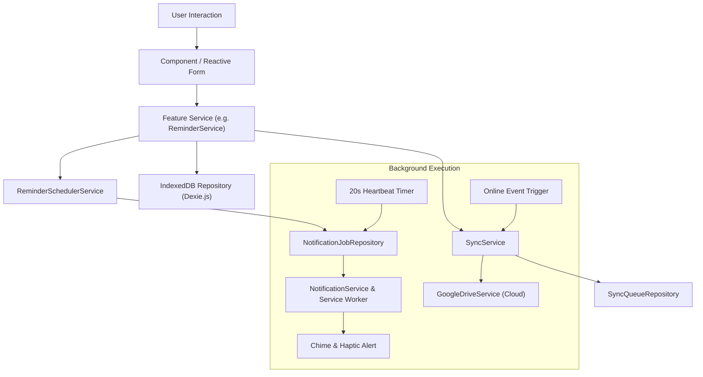

# Architecture Guide — REMINDER

This document details the architectural principles, component structure, state management, and communication patterns used in the REMINDER Progressive Web App.

---

## 1. Architectural Principles

### 1.1 Offline-First by Design
All user actions (creating, updating, completing, snoozing, and deleting reminders, events, and birthdays) write **synchronously to IndexedDB** via Dexie.js. No core workflow requires an active network connection. The application never stalls waiting for Google Drive or network responses.

### 1.2 Separation of Concerns
- **Core Models (`src/app/core/models/`)**: Pure TypeScript domain interfaces (`Reminder`, `EventRecord`, `Birthday`, `SyncQueueRecord`, `AttachmentRecord`).
- **Data Access Layer (`src/app/database/`)**: Isolated Dexie repository classes (`ReminderRepository`, `EventRepository`, `BirthdayRepository`, `NotificationJobRepository`, `SyncQueueRepository`, `AttachmentRepository`). Components never directly touch database tables.
- **Business Services (`src/app/core/services/` & `src/app/features/*/`)**: Services own all business logic, notification scheduling, calendar conversions, and cloud sync pipelines.
- **UI Components**: Small, standalone Angular 20 components driven by Signals and Reactive Forms.

### 1.3 Angular Signals
State reactivity is modeled using Angular Signals:
- `signal<T>` for mutable state.
- `computed(() => ...)` for derived calculations (e.g. `filteredReminders`, `birthdaysWithCountdown`, `completionRate`).
- Dexie live queries pipe into Signals using RxJS interop via `IndexedDbService.observe(...)`.

---

## 2. Directory Structure

```
src/
├── app/
│   ├── app.config.ts                     # Application providers & routes
│   ├── app.routes.ts                     # Lazy-loaded feature routes
│   ├── app.ts                            # Root shell component
│   ├── app.html                          # Root shell layout with toast and modal hosts
│   │
│   ├── core/                             # Application core
│   │   ├── models/                       # Domain interfaces & TypeScript types
│   │   ├── pipes/                        # TranslatePipe, NepaliNumeralPipe
│   │   └── services/                     # AuthService, GoogleDriveService, SyncService,
│   │                                     # NotificationService, ReminderSchedulerService,
│   │                                     # NepaliCalendarService, FestivalService, I18nService
│   │
│   ├── database/                         # Dexie IndexedDB abstraction
│   │   ├── db.ts                         # ReminderDatabase schema definition
│   │   └── repositories/                 # BaseRepository & entity repositories
│   │
│   ├── features/                         # Feature modules
│   │   ├── dashboard/                    # Overview, stats, bills & festival ticker
│   │   ├── calendar/                     # Month, Week, Day, and Year dual views
│   │   ├── reminders/                    # Reminder CRUD, search, filter, card, form, snooze
│   │   ├── birthdays/                    # Birthdays & anniversaries with countdowns
│   │   ├── events/                       # Multi-day events & appointments
│   │   └── settings/                     # Config: Google account, sync, notifications, i18n
│   │
│   └── shared/                           # Shared UI primitives
│       └── components/                   # Header, Sidebar, BottomNav, Card, Modal,
│                                         # Button, EmptyState, ConflictModal, GlobalSearchModal
│
├── environments/                         # Environment config (OAuth client ID, scopes)
└── public/                               # PWA manifest, service worker, icons
```

---

## 3. Data Flow Diagram



---

## 4. Single-User Authorization Guard

The application is architected strictly for a single private user. The Google OAuth configuration includes an `authorizedEmail` property. When a user logs in:
1. The Google OAuth token is obtained via Google Identity Services.
2. The user profile is retrieved from `https://www.googleapis.com/oauth2/v3/userinfo`.
3. If `authorizedEmail` is configured and does not match the authenticated email:
   - Access token is immediately revoked.
   - User is logged out.
   - An explicit error alert is displayed.

