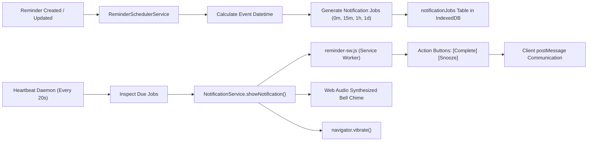

# Notifications & Reminder Engine Guide

This document describes the offline alert architecture, multi-schedule engine, background heartbeat inspection, and Service Worker notification handling.

---

## 1. Notification Architecture



---

## 2. Multi-Schedule Lead Times

Reminders support multiple alert times:
- At reminder time (`0m`)
- 5 minutes before (`5m`)
- 10 minutes before (`10m`)
- 15 minutes before (`15m`)
- 30 minutes before (`30m`)
- 1 hour before (`60m`)
- 1 day before (`1440m`)
- 7 days before (`10080m`)

Each selected lead time generates a distinct row in the `notificationJobs` table with an absolute ISO scheduled timestamp.

---

## 3. Quiet Hours (Do Not Disturb)

Quiet hours can be configured in [Settings](src/app/features/settings/settings.component.ts) (e.g., 10:00 PM to 07:00 AM).
- **Overnight Range Detection**: Accurately computes ranges crossing midnight.
- **Silent Mode**: Suppresses audio chime and haptic vibration while displaying the visual alert.
- **Urgent Overrides**: Reminders marked with `urgent` priority will override quiet hours to alert the user for emergencies.

---

## 4. Service Worker Background Actions

When an alert triggers in the background:
```javascript
// public/reminder-sw.js
self.addEventListener('notificationclick', (event) => {
  event.notification.close();
  const action = event.action;
  const reminderId = event.notification.data?.reminderId;

  if (action === 'complete') {
    // Deliver message to active client window
    client.postMessage({ type: 'NOTIFICATION_ACTION', action: 'complete', reminderId });
  } else if (action === 'snooze') {
    // Snooze by default 15 minutes
    client.postMessage({ type: 'NOTIFICATION_ACTION', action: 'snooze', reminderId });
  }
});
```

Clients receive the action event and automatically invoke `ReminderService.toggleComplete()` or `ReminderService.snoozeReminder()`.

